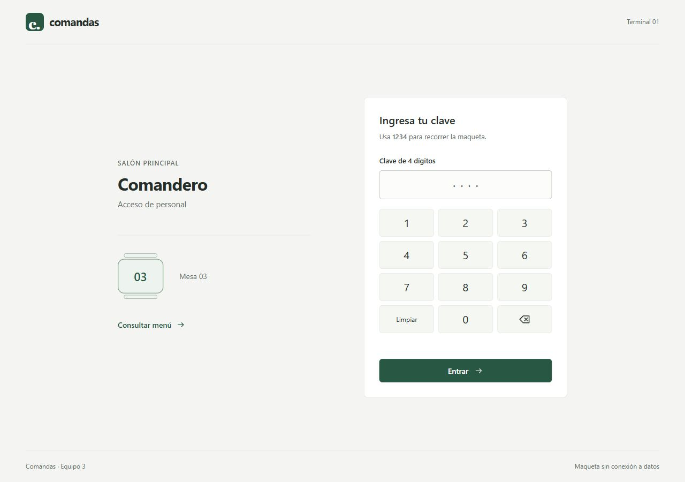
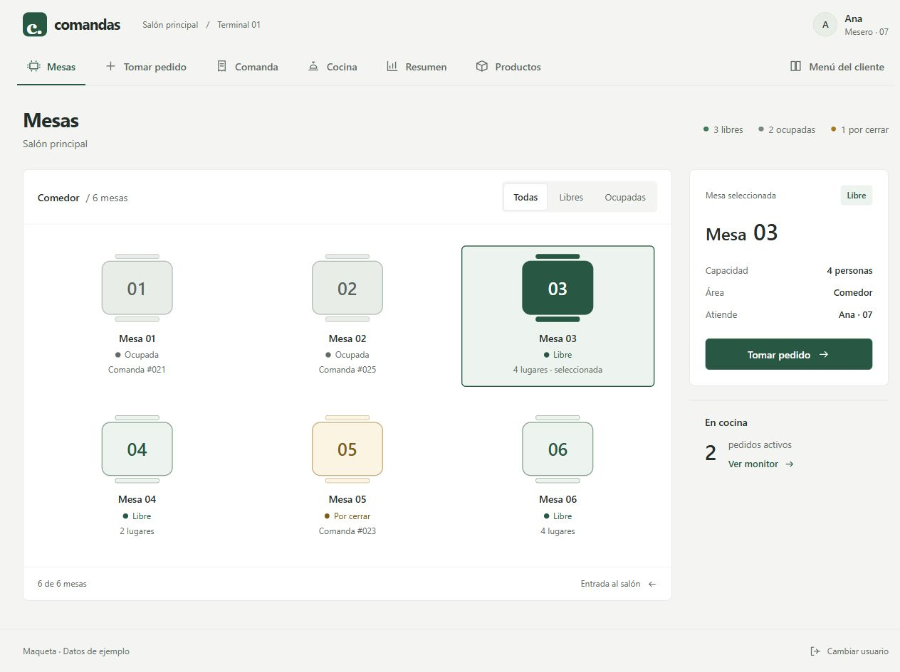

# Comandas

Maqueta de un comandero para restaurante. **Nombre provisional · Equipo 3 · LITIID42.**

Para revisar el código en VS Code, extrae el ZIP completo y abre **Comandas.code-workspace** o la carpeta **comandas-maqueta**. En [LEEME-PRIMERO.txt](LEEME-PRIMERO.txt) está la ubicación de cada pantalla. Los archivos `.tsx` son los componentes originales de React con TypeScript; `index.html` es el punto de entrada.

## Proyecto

El mesero selecciona cualquiera de las seis mesas y recorre su pedido de muestra, detalle y cierre. Las mesas libres permiten tomar pedido; las ocupadas, ver su comanda; las que están por cerrar, consultar la cuenta. El administrador consulta las ventas y el catálogo. El menú del cliente es una vista complementaria.

Se usa React, TypeScript, HTML semántico y Tailwind CSS. Los datos son ficticios. El diseño usa una barra compacta, plano del salón, tickets de pedido y un menú del cliente independiente. En móvil, la navegación se despliega y el catálogo se reorganiza. Las decisiones están en [DESIGN.md](DESIGN.md).

## Ejecutar

Se requiere Node.js 22.12 o una versión posterior compatible con Vite.

~~~sh
npm install
npm run dev
~~~

Para revisar TypeScript y generar la compilación:

~~~sh
npm run build
~~~

En esta laptop, si una terminal antigua muestra «npm: command not found», ciérrala y abre otra desde **Terminal > New Terminal** en VS Code. Node.js ya está instalado para el usuario.

## Probar la maqueta

1. Escribe **1234** en el acceso. También puedes usar el teclado numérico de la pantalla.
2. En Mesas, cambia entre Todas, Libres y Ocupadas.
3. Haz clic en una mesa para seleccionarla. El panel muestra su número, capacidad y estado. Usa Tomar pedido, Ver comanda o Cerrar cuenta según corresponda.
4. En una mesa libre, abre Tomar pedido; busca un platillo o elige una categoría.
5. Enviar a cocina → detalle de la comanda → Ver en cocina.
6. Vuelve al detalle → Cerrar cuenta → Confirmar cierre.
7. Usa Resumen, Productos y Menú del cliente para revisar las demás pantallas.

La clave 1234 solo cambia de pantalla; **no hay autenticación real**. Los pedidos están predefinidos por mesa. El ejemplo de la mesa 03 suma **$290 MXN**; el de la mesa 02 suma **$85 MXN**. Seleccionar una mesa conserva su contexto al navegar; recargar reinicia la maqueta.

Enviar y cerrar recorren escenas de ejemplo, sin guardar pedidos ni modificar mesas. El monitor conserva la mesa del último envío simulado junto con el pedido de muestra de la mesa 02. Cocina usa los estados **En cocina → Listo**; el tiempo indica lo transcurrido desde el envío de muestra. Agregar productos, confirmar Pedido listo y publicar reseñas siguen deshabilitados.

## Pantallas y archivos

| Archivo en src/pages | Objetivo |
|---|---|
| Acceso.tsx | Acceso de muestra con teclado numérico |
| Mesas.tsx | Plano, selección de las seis mesas y filtros de estado |
| NuevaComanda.tsx | Catálogo, búsqueda y resumen fijo del pedido |
| Detalle.tsx | Comanda de ejemplo y accesos a cocina y cierre |
| Cocina.tsx | Monitor con los estados En cocina y Listos |
| Cierre.tsx | Confirmación visual de cierre |
| Dashboard.tsx | Ventas del día y productos más pedidos |
| Productos.tsx | Catálogo del administrador |
| MenuCliente.tsx | Menú y reseña de ejemplo |

## Navegación

~~~text
Acceso --1234--> Mesas --seleccionar mesa libre--> Tomar pedido
                                               |
                                         Enviar a cocina
                                               v
                                           Comanda
                                          /       |
                                      Cocina     Cierre
                                         |         |
                                      Comanda  Confirmar
                                                   |
                                              Mapa de mesas

Barra superior: Mesas / Tomar pedido / Comanda / Cocina / Resumen / Productos
               Menú del cliente -> vista independiente -> Volver
Pie: Cambiar usuario -> Acceso
Acceso -> Consultar menú
~~~

La barra superior permite cambiar de sección y el pie regresar al acceso. Este mapa describe la navegación del prototipo; el diagrama completo del proceso del negocio sigue pendiente para el reporte.

## Estructura

~~~text
src/
  pages/          Una pantalla por archivo TSX
  components/     AppLayout, Brand, Icon y elementos de UI
  data/           Datos ficticios en demo.ts
  types/          Tipos de navegación
  App.tsx         Selección de pantalla
  index.css       Sistema visual y estilos responsivos
docs/
  prototipo/      Capturas actuales de escritorio y móvil
  entrega.md      Revisión del PDF y pasos para GitHub
~~~

Se conservan src/pages y src/components, como pide la actividad. src/data contiene solo datos de prueba.

## Evidencia actual

| Acceso | Mesas |
|---|---|
|  |  |

Las otras capturas están en [docs/prototipo](docs/prototipo). La revisión técnica está en [VALIDACION.md](VALIDACION.md) y la propuesta aplicada en [DESIGN.md](DESIGN.md).

Bocetos anteriores del equipo: [Figma](https://www.figma.com/design/QvEFA0QrpoUZJplKyPB79G). Esos bocetos corresponden a la propuesta anterior; falta ajustarlos a esta distribución.

## Equipo

Integrantes indicados en la actividad:

- Chablé Aké Habib Gonzalo
- Martínez Ballanes Sebastián
- De la Cruz Loeza Alan Daniel
- Maldonado Ramírez Jonathan Alexis
- Cortés Granda Susan Neftalí

## Entrega

La actividad completa todavía requiere el reporte con proceso, reglas, inventario, bocetos de baja fidelidad y mapa de navegación; además, subir y verificar el repositorio compartido. Consulta [la revisión de entrega](docs/entrega.md).
